# Smart Detector – Butane gas detection, alert & automatic extraction

Smart Detector is an Arduino-based prototype that **detects a butane gas leak inside a home, warns the occupant (LCD, LEDs, SMS and phone call) and automatically evacuates the gas** by opening a window and switching on an extraction fan.

The project was presented as an academic project by **EL-AZHARY Salah-Eddine**. The full presentation (in French) is available in [`Smart-detector-project.pdf`](Smart-detector-project.pdf); this repository contains the source code extracted from its annexes, cleaned up so it compiles and runs, plus the documentation of the whole project.

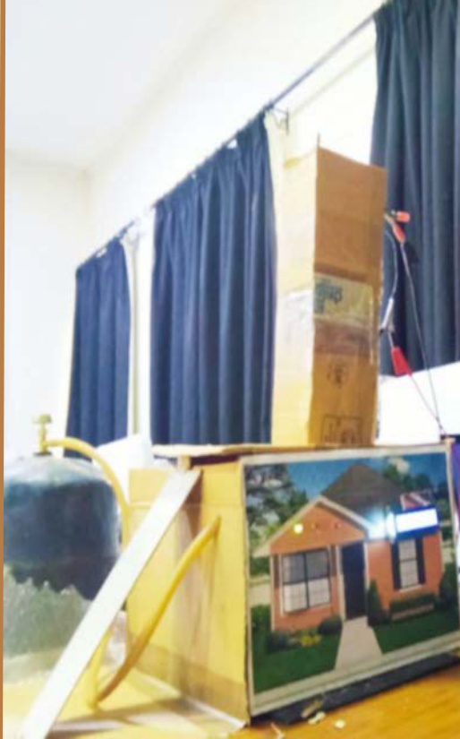

---

## Table of contents

1. [Context](#1-context)
2. [Problem statement](#2-problem-statement)
3. [Objectives](#3-objectives)
4. [How it works](#4-how-it-works)
5. [Functional analysis](#5-functional-analysis)
6. [Component choices](#6-component-choices)
7. [Hardware & wiring](#7-hardware--wiring)
8. [Repository structure](#8-repository-structure)
9. [Firmware](#9-firmware)
10. [Gas extraction study (fan & tube)](#10-gas-extraction-study-fan--tube)
11. [Experimental results](#11-experimental-results)
12. [Data analysis script](#12-data-analysis-script)
13. [Changes compared to the code in the PDF](#13-changes-compared-to-the-code-in-the-pdf)
14. [Limitations & future work](#14-limitations--future-work)
15. [Safety disclaimer](#15-safety-disclaimer)
16. [Author](#16-author)

---

## 1. Context

Domestic gas cylinders (butane) are still widely used for cooking and heating, and leaks regularly end in deadly explosions:

- **Casablanca, 2020** – deaths and injuries after a gas cylinder explosion in the Al-Charak district.
- **Paris, January 2019** – the rue de Trévise explosion caused by a gas leak.

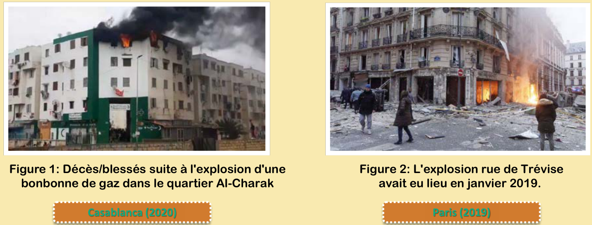

Butane (C₄H₁₀) is heavier than air, odourless in its pure form and highly flammable. Its combustion is:

```text
2 C4H10 + 13 O2  ->  8 CO2 + 10 H2O
```

A leak is dangerous because the gas accumulates silently in a closed room until a spark ignites it.

## 2. Problem statement

> **How can we detect a gas leak and completely extract the gas, while making sure the user receives the information as reliably as possible?**

## 3. Objectives

The project is split into three main goals (**Detection → Inform the user → Automatic extraction**) and four technical objectives:

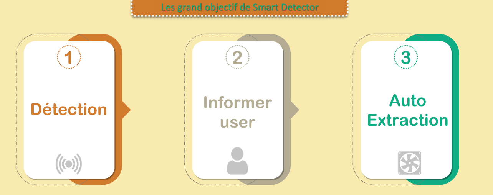

| # | Objective | What was done |
|---|-----------|---------------|
| 1 | **Gas detection** | Study of butane, comparison of MQ-2 and MQ-5 sensors, choice of the **MQ-5** |
| 2 | **Warn the user** | Visual warning (16x2 LCD + 3 LEDs) and remote warning by **SMS + phone call** through a **SIM800L** GSM module |
| 3 | **Natural extraction** | A **servo motor** opens a window (0° → 90°) to let the gas out |
| 4 | **Forced extraction** | An **extraction fan** + a study of the **extraction tube shape** (continuity equation, HELYX and ANSYS simulations) |

## 4. How it works

The MQ-5 analog output is read continuously by the Arduino UNO (`analogRead`, 0–1023) and classified into three zones using two thresholds:

| Zone | Condition | LCD (line 1 / line 2) | LED | Fan | Window | SMS + call |
|------|-----------|------------------------|-----|-----|--------|------------|
| **Danger** | value > **500** | `Dangereux!!!` / value | 🔴 red | ON | opened (90°) | yes |
| **Warning** | 250 < value ≤ 500 | `l'environnement!` / value | 🟡 yellow | ON | closed (0°) | yes (configurable) |
| **Safe** | value ≤ **250** | `aucun gas detect` / value | 🟢 green | OFF | unchanged | no |

Flowchart from the presentation:

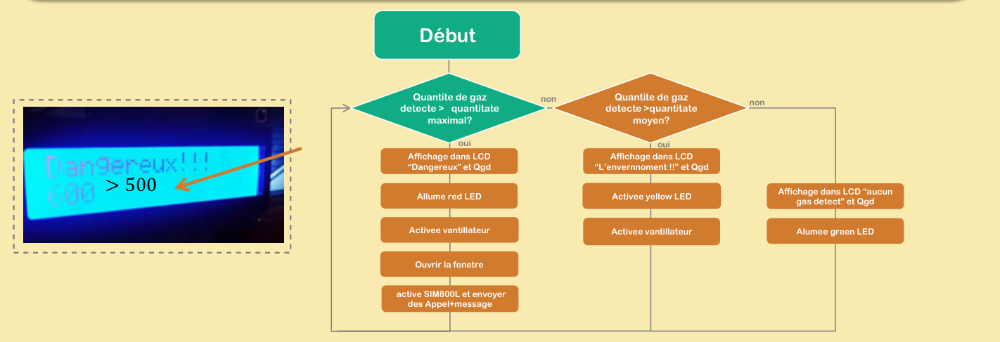

> **Note:** in the flowchart, the SMS/call and the window opening are only triggered in the danger zone, whereas the final code of the project also sends the SMS/call in the warning zone. The firmware in this repository keeps the behaviour of the code and exposes it as a setting (`ALERT_ON_WARNING`), so you can choose either behaviour.

Every reading is also printed on the serial port (`Serial.println(value)`, 9600 baud). These logs were used to plot the experimental curves (see [section 11](#11-experimental-results)).

## 5. Functional analysis

The system is described with an **information chain** (acquire → process → display/communicate) driving an **energy chain** (supply → modulate → convert → transmit) whose final action is the extraction of the gas:

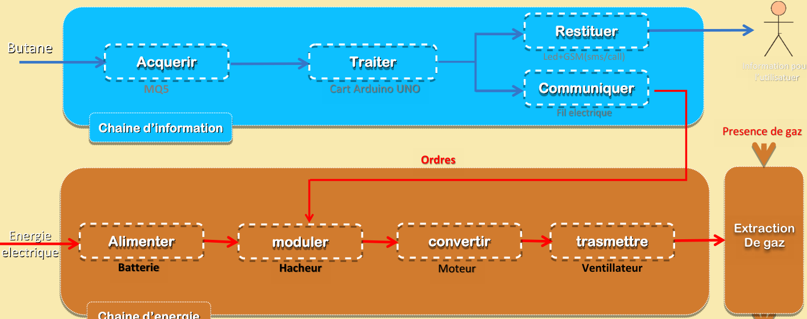

| Chain | Function | Component |
|-------|----------|-----------|
| Information | Acquire | MQ-5 gas sensor |
| Information | Process | Arduino UNO |
| Information | Display (restituer) | LCD + LEDs + GSM (SMS / call) |
| Information | Communicate | Electrical wires (orders to the energy chain) |
| Energy | Supply | Battery |
| Energy | Modulate | Chopper (transistor / MOSFET driver) |
| Energy | Convert | DC motor |
| Energy | Transmit | Fan blades |

## 6. Component choices

### Gas sensor: MQ-5 vs MQ-2

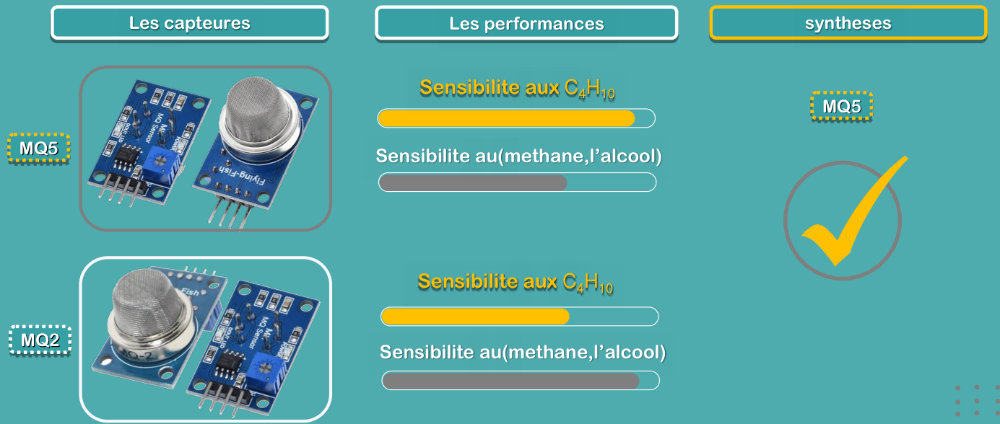

Both sensors react to LPG/butane, but the **MQ-5** is more sensitive to butane (C₄H₁₀) and less sensitive to interfering gases such as methane and alcohol vapour, so it gives fewer false alarms in a kitchen. **→ MQ-5 selected.**

### Remote alert module: SIM800L vs ESP8266 vs HC-05

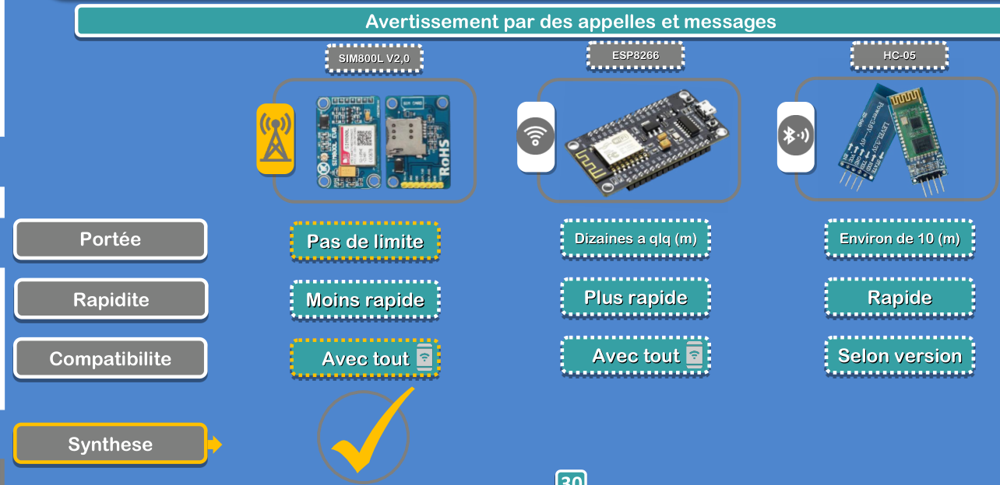

| Module | Range | Speed | Compatibility |
|--------|-------|-------|---------------|
| **SIM800L V2.0** (GSM) | Unlimited (mobile network) | Slower | Works with any phone |
| ESP8266 (Wi-Fi) | Tens of metres (Wi-Fi network) | Faster | Any device on the network |
| HC-05 (Bluetooth) | About 10 m | Fast | Depends on the version |

The user must be warned even when they are away from home and without an internet connection. **→ SIM800L selected** (SMS + phone call).

## 7. Hardware & wiring

### Bill of materials

| Qty | Component | Role |
|-----|-----------|------|
| 1 | Arduino UNO | Controller |
| 1 | MQ-5 gas sensor module | Butane / LPG detection |
| 1 | 16x2 LCD with I2C backpack (address `0x27`) | Display state and value |
| 3 | LEDs (red, yellow, green) + 220 Ω resistors | Visual warning |
| 1 | SIM800L V2.0 GSM module + SIM card | SMS and phone call |
| 1 | SG90 servo motor | Opens / closes the window |
| 1 | DC fan + transistor/MOSFET driver (+ flyback diode) | Gas extraction |
| 1 | Battery / external power supply | Powers the fan and the SIM800L |
| – | Breadboard, jumper wires | Prototyping |

### Real prototype and Tinkercad wiring diagram

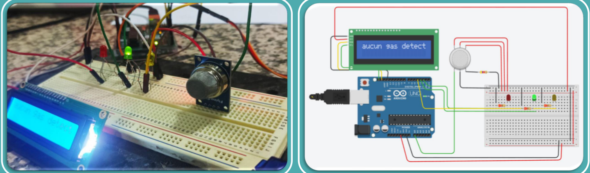

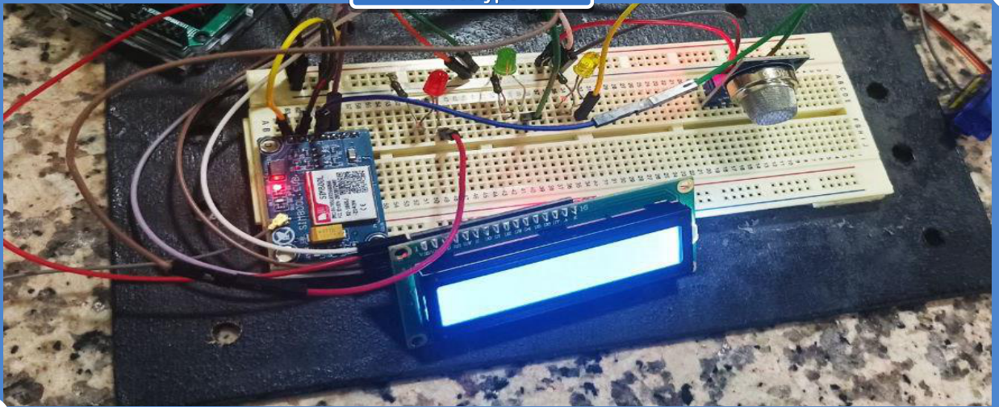

### Pinout (full version)

| Component pin | Arduino UNO pin | Notes |
|---------------|-----------------|-------|
| MQ-5 `AO` | `A0` | Analog output of the sensor |
| MQ-5 `VCC` / `GND` | `5V` / `GND` | |
| LCD `SDA` / `SCL` | `A4` / `A5` | I2C, address `0x27` |
| Red LED | `D2` | Through 220 Ω |
| Green LED | `D3` | Through 220 Ω |
| Yellow LED | `D4` | Through 220 Ω |
| Fan driver (transistor base / MOSFET gate) | `D5` | **Was `D11` in the PDF – see [section 13](#13-changes-compared-to-the-code-in-the-pdf)** |
| Servo signal | `D9` | Pulse range 500–2500 µs |
| SIM800L `TXD` | `D10` | SoftwareSerial RX |
| SIM800L `RXD` | `D11` | SoftwareSerial TX (a voltage divider to ~2.8–3.3 V is recommended) |

> **Power:** the SIM800L draws current peaks of up to 2 A and needs a 3.7–4.2 V supply (e.g. a Li-ion cell or a dedicated buck converter). Do not power it from the Arduino 5 V pin. The fan must also have its own supply, switched by the transistor; only grounds are shared with the Arduino.

The basic version only uses the MQ-5, the LCD and the three LEDs (same pins).

## 8. Repository structure

```text
.
├── README.md
├── Smart-detector-project.pdf             # Original presentation (French)
├── firmware/
│   ├── smart_detector_basic/
│   │   └── smart_detector_basic.ino       # MQ-5 + LCD + LEDs
│   └── smart_detector_full/
│       └── smart_detector_full.ino        # + SIM800L SMS/call + servo window + fan
├── analysis/
│   ├── plot_gas_concentration.py          # Plots the experimental curves
│   └── requirements.txt
└── docs/
    └── images/                            # Figures extracted from the presentation + generated plots
```

The two sketches are **Arduino C++**. The `.ino` extension is the format opened by the Arduino IDE, and each sketch lives in a folder with the same name, as the IDE requires. To use them with PlatformIO or another plain C++ toolchain, rename the file to `src/main.cpp` and add `#include <Arduino.h>` at the top.

## 9. Firmware

### Two versions

| Sketch | Features | Use it for |
|--------|----------|------------|
| [`smart_detector_basic`](firmware/smart_detector_basic/smart_detector_basic.ino) | MQ-5 reading, 3-zone classification, LCD message, LEDs, serial log | First test of the sensor, Tinkercad simulation |
| [`smart_detector_full`](firmware/smart_detector_full/smart_detector_full.ino) | Everything above + fan, servo-driven window, SMS + call through the SIM800L, alert anti-spam | The complete prototype |

### Required libraries

Install them from **Arduino IDE → Tools → Manage Libraries…**:

- **LiquidCrystal I2C** by Frank de Brabander
- **Servo** (bundled with the Arduino IDE; install it from the Library Manager when using `arduino-cli`)
- **SoftwareSerial** (part of the AVR core)

> If you installed the other `LiquidCrystal_I2C` fork from GitHub (the one where `lcd.begin()` takes no arguments), replace `lcd.init();` with `lcd.begin();` in `setup()`.

### Build & upload

**Arduino IDE**

1. Open `firmware/smart_detector_full/smart_detector_full.ino` (or the basic one).
2. Set your phone number in `PHONE_NUMBER` (full version only).
3. Select **Tools → Board → Arduino UNO** and the right port.
4. Click **Upload**, then open the **Serial Monitor** at 9600 baud to see the readings.

**arduino-cli**

```bash
arduino-cli core install arduino:avr
arduino-cli lib install "LiquidCrystal I2C" "Servo"
arduino-cli compile --fqbn arduino:avr:uno firmware/smart_detector_full
arduino-cli upload  --fqbn arduino:avr:uno -p COM3 firmware/smart_detector_full
```

### Configuration (top of `smart_detector_full.ino`)

| Constant | Default | Meaning |
|----------|---------|---------|
| `PHONE_NUMBER` | `"+212XXXXXXXXX"` | Number that receives the SMS and the call (international format) |
| `DANGER_THRESHOLD` | `500` | Above this raw value → danger zone |
| `WARNING_THRESHOLD` | `250` | Above this raw value → warning zone |
| `ALERT_ON_WARNING` | `true` | `false` = SMS/call only in the danger zone (like the flowchart) |
| `WINDOW_CLOSED_DEG` / `WINDOW_OPEN_DEG` | `0` / `90` | Servo angles of the window |
| `ALERT_COOLDOWN_MS` | `120000` | Minimum delay between two alerts of the same level |
| `SMS_TO_CALL_DELAY_MS` | `5000` | Pause between the SMS and the call so the SIM800L finishes sending |
| `LOOP_DELAY_MS` | `100` | Pause between two readings |

Memory usage on an Arduino UNO (arduino:avr 1.8.8): the basic sketch uses 6.4 KB of flash (19 %) and 520 B of RAM (25 %); the full sketch uses 10.8 KB of flash (33 %) and 743 B of RAM (36 %).

### Alert logic

To avoid sending an SMS and a call on **every loop iteration** (about 7 times per second), an alert is sent only when:

- the level **escalates** (safe → warning, warning → danger), or
- the same alarm level is still present after `ALERT_COOLDOWN_MS` (reminder).

The alert memory is reset only after the gas has been back in the safe zone for a full cooldown period, so a reading oscillating around a threshold cannot flood the phone.

SIM800L AT commands used:

| Command | Purpose |
|---------|---------|
| `AT+CMGF=1` | Put the module in SMS text mode |
| `AT+CMGS="<number>"` then text then `Ctrl+Z` (ASCII 26) | Send the SMS |
| `ATD<number>;` | Start a voice call |

### Tinkercad simulation

Tinkercad has no MQ-5 or SIM800L, but the **basic** sketch can be simulated with its generic gas sensor, an I2C 16x2 LCD and three LEDs, as shown in the wiring diagram above. The window mechanism was also simulated (servo + window):

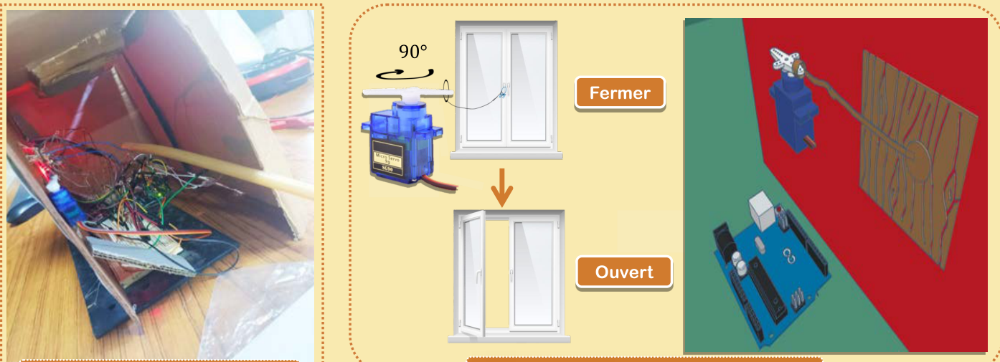

## 10. Gas extraction study (fan & tube)

### Fan

The fan forces the air flow out of the room. A **HELYX** CFD simulation of the fan shows the increase of the air velocity produced by its blades:

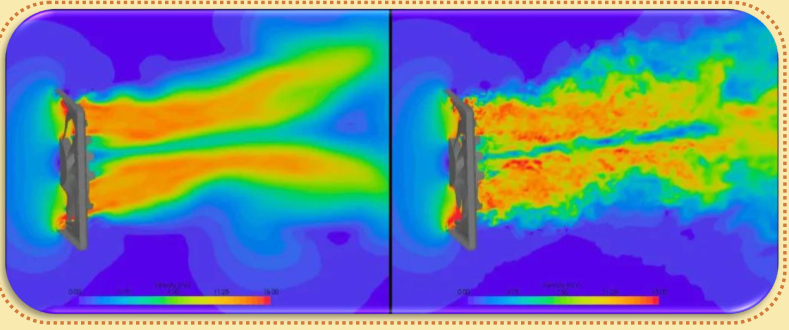

### Shape of the extraction tube

To improve the extraction even more, the shape of the tube placed after the fan was studied with the **continuity equation** (mass flow conservation, incompressible flow assumption):

$$S_1 \cdot v_1 = S_2 \cdot v_2$$

- With a **straight tube** (S₂ = S₁): v₂₁ = v₁, so the speed is unchanged.
- With a **converging tube** (S₂ < S₁): v₂₂ = v₁ · S₁ / S₂ > v₁, so the gas is expelled faster.

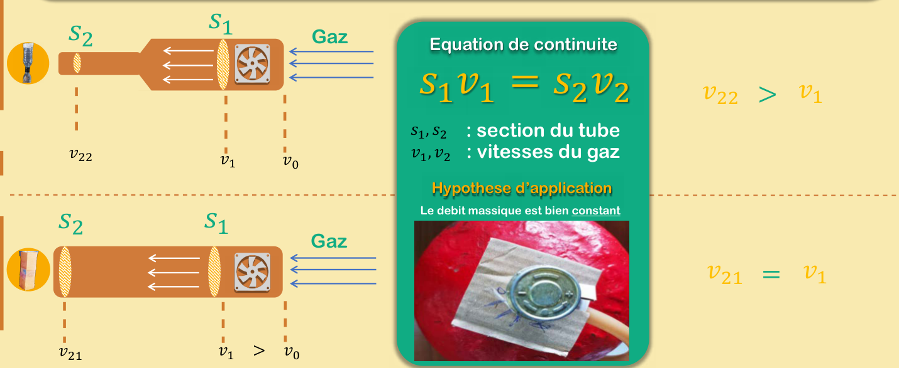

An **ANSYS** simulation confirms the higher velocity at the outlet of the converging tube compared with the straight one, so the **converging tube** was kept for the final prototype:

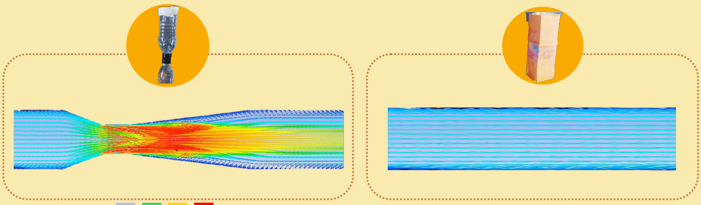

### Final prototype

The final model is a cardboard house connected to a butane cylinder, with the electronics, the LCD and LEDs on the façade, the servo-controlled window and the extraction tube with the fan on the roof (see the photo at the top of this page).

## 11. Experimental results

The serial readings of the MQ-5 were logged with timestamps from the Arduino Serial Monitor (114 samples over 15 s, about one reading every 133 ms) in two scenarios:

- **Without the fan:** the reading rises from ~70 (clean air) to **~510** after about 15 s and stays in the danger zone.
- **With the fan:** the reading follows the same rise until it reaches the **250 threshold** (t ≈ 4.6 s), the fan switches on and the reading falls back to the clean-air baseline (**53–65**) at the next samples and stays there.

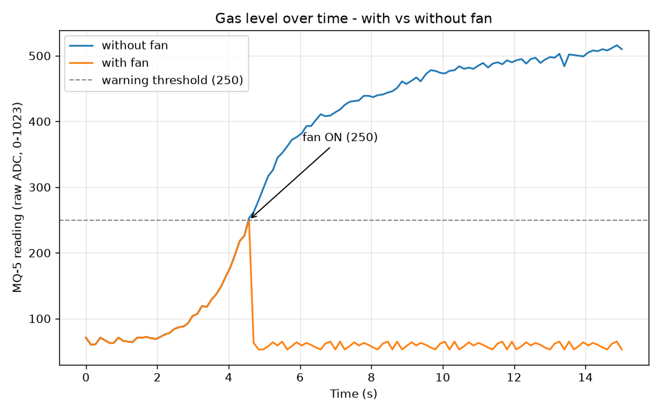

Original figure from the presentation:

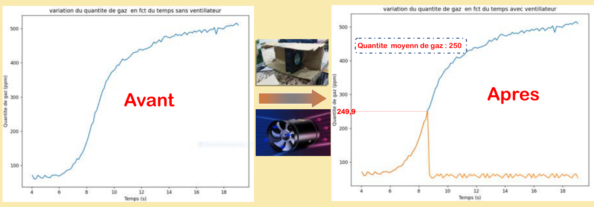

> The values are **raw ADC readings** (0–1023) from `analogRead`, not calibrated ppm. The presentation labels the axis "ppm"; a proper conversion requires calibrating the sensor (R₀ in clean air) and using the MQ-5 sensitivity curve, see [section 14](#14-limitations--future-work).

## 12. Data analysis script

[`analysis/plot_gas_concentration.py`](analysis/plot_gas_concentration.py) contains the measurements copied from the Serial Monitor and reproduces the figures above. The log was copied newest-first, so the script reverses it before plotting.

```bash
cd analysis
python -m pip install -r requirements.txt

python plot_gas_concentration.py                          # open the figures
python plot_gas_concentration.py --output ../docs/images  # save them as PNG
```

Example output:

```text
114 samples over 15.02 s (~133 ms per sample)
without fan  peak =  516 at t = 14.88 s, final =  510
with fan     peak =  250 at t =  4.57 s, final =   53
```

It produces `gas_without_fan.png` and `gas_with_vs_without_fan.png`.

## 13. Changes compared to the code in the PDF

The code in the annexes of the presentation was transcribed and the following problems were fixed:

**Both sketches**

| Problem in the PDF code | Fix |
|-------------------------|-----|
| `#include <MQ5.h>` / `<MQUnifiedsensor.h>`: `MQ5.h` does not exist in that library and neither library is used (the sensor is read with `analogRead`), so the sketch could not compile | Removed |
| Two independent `if` blocks followed by `else` | Replaced with a single `if / else if / else` classification (`classify()`) |
| A value of exactly `500` matched neither zone and was displayed as "no gas" | Thresholds are now contiguous: > 500 danger, > 250 warning, otherwise safe |
| `lcd.clear()` on every loop made the display flicker | Each line is overwritten and padded with spaces instead |
| `" to smart detector"` (18 chars) and `"aucun gas detecte"` (17 chars) do not fit on a 16-column LCD | Shortened to fit; the welcome screen is shown for 2 s |
| Magic numbers and global `int` pins | Named `const` settings grouped at the top |

**Basic sketch only**

| Problem | Fix |
|---------|-----|
| Unbalanced braces (`} else {` after a closed `if`, extra `}` at the end) – did not compile | Rewritten with balanced blocks |

**Full sketch only**

| Problem | Fix |
|---------|-----|
| `_buffer.reserve(50);`: `_buffer` is never declared – did not compile | Removed (unused) |
| **Pin conflict:** the fan was on `D11`, which is also the SoftwareSerial TX pin of the SIM800L (`SoftwareSerial sim(10, 11)`) | Fan moved to `D5` |
| In the danger zone, the following `else` (of the warning `if`) also ran, which immediately showed "no gas", turned the green LED on and **switched the fan off** | Fixed by the `if / else if / else` chain |
| An SMS **and** a call were sent on every loop (~7 per second) as long as gas was present | Alerts are sent on escalation, then at most once per cooldown |
| The call was started immediately after the SMS, while the SIM800L was still busy sending it | 5 s pause between the SMS and the call |
| The servo swept 0→90° (or 90→0°) again on every loop, making the window jerk | The servo only moves when the target position changes; one step every 15 ms as stated in the original comments (the code used 1 ms) |
| Personal phone number hard-coded | Replaced with the placeholder `+212XXXXXXXXX` |

**Python script**

| Problem | Fix |
|---------|-----|
| Two near-identical scripts (pages 59 and 60 of the PDF), the second one only available as an image | Merged into one script that produces both figures |
| Time axis computed with a hard-coded `- 20` seconds offset | Time is computed relative to the first sample |
| The "with fan" title was used for the curve without fan; y-axis labelled ppm | Correct titles and legend; the axis is labelled as a raw ADC reading |

## 14. Limitations & future work

- **Calibration:** the MQ-5 needs a burn-in period (24–48 h) and a calibration in clean air to convert readings into ppm (for example with the `MQUnifiedsensor` library). The thresholds 250/500 were set experimentally on this prototype.
- **Blocking code:** the servo motion and the SIM800L commands use `delay()`, so the loop is paused for a few seconds while an alert is sent. A non-blocking state machine (`millis()`) would keep the display and the readings updating.
- **GSM feedback:** the module responses (`OK`, `+CMGS`, `ERROR`, network registration) are not read, and the call is never hung up (`ATH`) by the firmware.
- **Gas supply:** add a **solenoid valve** to cut the gas supply automatically in the danger zone.
- **Local alarm:** add a buzzer for people who are inside the house.
- **Connectivity:** combine the SIM800L with an ESP8266/ESP32 to log readings to a cloud dashboard or a mobile app.
- **Power autonomy:** add a battery backup so the detector keeps working during a power cut.
- **Hardware:** move from the breadboard to a PCB inside an enclosure.

## 15. Safety disclaimer

This is an **educational prototype**. It is not a certified gas detector and must not replace a standards-compliant detector (e.g. EN 50194). If you build it, test it with very small amounts of gas, in a ventilated area, far from any flame or spark.

## 16. Author

**EL-AZHARY Salah-Eddine**
